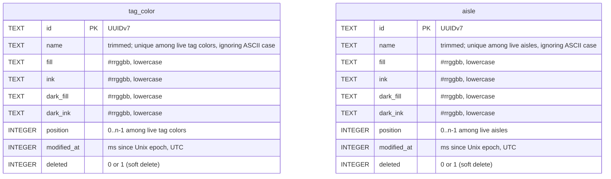

# Database schema

The migrations in [core/schema/](../core/schema/) are the source of truth; this page explains them. Conventions shared by every table are in [CLAUDE.md](../CLAUDE.md#database-conventions).

There's no relation between the two tables: an aisle copies a tag color's four colors when it gets them.

## Colors

`tag_color` and `aisle` store colors the same way: four columns, read and written together as one `core::ThemedColors`.

| Column | Holds |
| --- | --- |
| `fill`, `ink` | In the light theme: the background, and the text and icons drawn on it. |
| `dark_fill`, `dark_ink` | The same in the dark theme. |

- **Format**: `#rrggbb`, lowercase hex, no alpha. The CHECK constraints (`GLOB '#[0-9a-f]...'`) accept nothing else, and `core::rgbFromText` parses nothing else, so equal colors have equal text. In C++, a color is a `core::Rgb`, so an invalid one can't reach a store.
- **Loading**: a stored color that isn't `#rrggbb` throws `DatabaseError` (`SQLITE_CORRUPT`). Only a write that bypassed the CHECK constraints can cause it.
- **Theme**: QML picks the pair with `UiTheme.dark`.

## tag_color

The colors offered for tags and aisles. Created by `001_catalog.sql`, loaded by `core::TagColorStore`, tested in `core/tests/tagColorStoreTests.cpp`.

**Read-only for now**: the store only loads the live rows, in position order (ties by id). It has no operations yet, so nothing in the app writes this table.

**Name**: unique among live tag colors, ignoring ASCII case: the partial index `tag_color_name_live`, like `aisle_name_live`. Seeded in English; the app doesn't translate them.

**Seed rows**, in hue order with the neutral last, positions 0 to 7: Rose, Peach, Butter, Mint, Aqua, Sky, Lavender, Oat. Peach, Butter, Mint and Sky are the design's `tag-*` tokens (`docs/design/tokens.json`); the other four share their OKLCH lightness and chroma, with another hue. Every ink has 7:1 contrast or more on its fill, in both themes. Their ids and `modified_at` are fixed, so every device starts with identical rows.

## aisle

User-defined aisles that group the shopping list. Created by `001_catalog.sql`, managed by `core::AisleStore`, tested in `core/tests/aisleStoreTests.cpp`.

**Name**
- Trimmed of ASCII whitespace; empty → `EmptyName`.
- Unique among live aisles, ignoring ASCII case → `DuplicateName`. The store mirrors the partial index `aisle_name_live` (`COLLATE NOCASE ... WHERE deleted = 0`), so a deleted aisle's name can be reused. Non-ASCII letters don't fold: "Épices" and "épices" are different names.

**Colors**: the aisle's own copy, usually of a tag color's (see [Colors](#colors)). Changing or deleting a tag color later doesn't touch the aisles that copied it.

**Position**: live aisles always have positions 0..n-1, without gaps. If a gap or a duplicate ever reaches the database, loading renumbers the live aisles in order (ties by id) and updates `modified_at` on the renumbered rows. There's deliberately no unique index on `position`: SQLite checks UNIQUE row by row, so shifting several positions in one UPDATE would collide halfway.

**Operations**

| Operation | Effect |
| --- | --- |
| create | Appended last. |
| rename, setColors | One row. No write if nothing changes. setColors writes the four color columns together. |
| move(from, to) | The aisles in between shift by one. |
| remove | Soft delete (`deleted = 1`), then the live aisles after it shift up to close the gap. The deleted row keeps its old position. |
| restore | Back at min(old position, live count), shifting the others down. Fails with `DuplicateName` if a live aisle took the name meanwhile. |

- move, remove and restore are each one transaction.
- `modified_at` is updated on every row a change touches, including rows shifted by move, remove or restore.

**Seed rows**: Produce (Mint's colors), Dairy & eggs (Butter's), Meat & fish (Peach's), Pantry (Sky's), at positions 0 to 3. Their ids and `modified_at` are fixed, so every device starts with identical rows.

**"Other"** is not a row: the UI shows it for items whose aisle is gone.

**Not yet enforced**: an aisle can only be deleted while empty. That needs the shopping-list table; see the TODO in `AisleStore::remove`.
