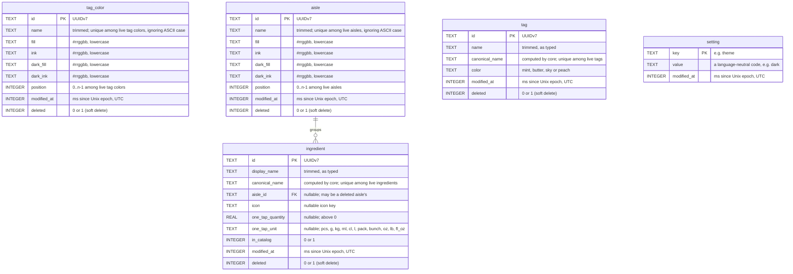

# Database schema

The migrations in [core/schema/](../core/schema/) are the source of truth; this page explains them. Conventions shared by every table (but `setting`, see [below](#setting)) are in [CLAUDE.md](../CLAUDE.md#database-conventions).

There's no relation between `tag_color` and `aisle`: an aisle copies a tag color's four colors when it gets them. `tag` doesn't use `tag_color` either: it stores one of the theme's four tag families by key. `tag` and `setting` stand alone for now: recipes will link to tags.

## Colors

`tag_color` and `aisle` store colors the same way: four columns, read and written together as one `core::ThemedColors`.

| Column | Holds |
| --- | --- |
| `fill`, `ink` | In the light theme: the background, and the text and icons drawn on it. |
| `dark_fill`, `dark_ink` | The same in the dark theme. |

- **Format**: `#rrggbb`, lowercase hex, no alpha. The CHECK constraints (`GLOB '#[0-9a-f]...'`) accept nothing else, and `core::rgbFromText` parses nothing else, so equal colors have equal text. In C++, a color is a `core::Rgb`, so an invalid one can't reach a store.
- **Loading**: a stored color that isn't `#rrggbb` throws `DatabaseError` (`SQLITE_CORRUPT`). Only a write that bypassed the CHECK constraints can cause it.
- **Theme**: QML picks the pair with `UiTheme.dark`.

## tag_color

The colors offered for tags and aisles. Created by `001_catalog.sql`, loaded by `core::TagColorStore`, tested in `core/tests/tagColorStoreTests.cpp`.

**Read-only for now**: the store only loads the live rows, in position order (ties by id). It has no operations yet, so nothing in the app writes this table.

**Not used by the screens yet**: the aisle screens offer the theme's four tag families (Mint, Butter, Sky, Peach: `app/AisleColors.qml`), whose values equal these rows', and tags store one of those families by key (see [tag](#tag)).

**Name**: unique among live tag colors, ignoring ASCII case: the partial index `tag_color_name_live`, like `aisle_name_live`. Seeded in English; the app doesn't translate them.

**Seed rows**, in hue order with the neutral last, positions 0 to 7: Rose, Peach, Butter, Mint, Aqua, Sky, Lavender, Oat. Peach, Butter, Mint and Sky are the design's `tag-*` tokens (`docs/design/tokens.json`); the other four share their OKLCH lightness and chroma, with another hue. Every ink has 7:1 contrast or more on its fill, in both themes. Their ids and `modified_at` are fixed, so every device starts with identical rows.

## aisle

User-defined aisles that group the shopping list. Created by `001_catalog.sql`, managed by `core::AisleStore`, tested in `core/tests/aisleStoreTests.cpp`.

**Name**
- Trimmed of ASCII whitespace; empty → `EmptyName`.
- Unique among live aisles, ignoring ASCII case → `DuplicateName`. The store mirrors the partial index `aisle_name_live` (`COLLATE NOCASE ... WHERE deleted = 0`), so a deleted aisle's name can be reused. Non-ASCII letters don't fold: "Épices" and "épices" are different names.

**Colors**: the aisle's own copy, usually of a tag color's (see [Colors](#colors)). Changing or deleting a tag color later doesn't touch the aisles that copied it.

**Position**: live aisles always have positions 0..n-1, without gaps. If a gap or a duplicate ever reaches the database, loading renumbers the live aisles in order (ties by id) and updates `modified_at` on the renumbered rows. There's deliberately no unique index on `position`: SQLite checks UNIQUE row by row, so shifting several positions in one UPDATE would collide halfway.

**Operations**

| Operation | Effect |
| --- | --- |
| create | Appended last. |
| rename, setColors | One row. No write if nothing changes. setColors writes the four color columns together. |
| move(from, to) | The aisles in between shift by one. |
| remove | Refused (`InUse`) while catalog items are in the aisle. Otherwise soft delete (`deleted = 1`), then the live aisles after it shift up to close the gap. The deleted row keeps its old position. |
| restore | Back at min(old position, live count), shifting the others down. Fails with `DuplicateName` if a live aisle took the name meanwhile. |

- move, remove and restore are each one transaction.
- `modified_at` is updated on every row a change touches, including rows shifted by move, remove or restore.

**Seed rows**: Produce (Mint's colors), Dairy & eggs (Butter's), Meat & fish (Peach's), Pantry (Sky's), at positions 0 to 3. Their ids and `modified_at` are fixed, so every device starts with identical rows.

**"Other"** is not a row: the UI shows it for ingredients whose aisle is gone.

**Deleting**: refused while catalog items are in the aisle; ingredients outside the catalog don't hold it back, and show under "Other" once it's gone. Shopping-list items will hold it too; see the TODO in `AisleStore::remove`.

## ingredient

The ingredient dictionary, which recipes will link to, and the shopping catalog: the rows with `in_catalog = 1`. Created by `001_catalog.sql`, managed by `core::IngredientStore`, tested in `core/tests/ingredientStoreTests.cpp`.

**Names**
- `display_name`: trimmed of ASCII whitespace, as the user typed it.
- `canonical_name`: `core::canonicalName(display_name)`: lowercase, accents removed, whitespace (no-break spaces too) trimmed and collapsed. "Crème  Fraîche" gives "creme fraiche". It folds ASCII and the Latin-1 and Latin Extended-A letters (œ gives "oe", ß "ss") and typographic apostrophes; other scripts stay as they are. No plural folding: "egg" and "eggs" are two ingredients.
- `canonical_name` is unique among live ingredients, catalog items or not: the partial index `ingredient_canonical_name_live`. Empty once folded → `EmptyName`.
- Search matches folded names: "creme" finds "Crème fraîche".

**Columns**
- `aisle_id`: references `aisle`. Since aisles are only soft-deleted, it can point to a deleted aisle: the UI then shows the ingredient under "Other".
- `icon`: an icon key, the file name of an icon in `app/ui/icons/ingredients/` without `.svg`. NULL: the UI shows the jar.
- `one_tap_quantity` and `one_tap_unit`: what one tap adds to the shopping list. Both set or both NULL (CHECK). Units are codes, mapped to `core::Unit`: the metric `pcs`, `g`, `kg`, `ml`, `cl`, `l`, `pack`, `bunch` and the US `oz`, `lb`, `fl_oz`. The unit system setting only changes which units the app offers and how amounts are shown, never the stored unit.
- A catalog row has an aisle and a one-tap amount (CHECK). The store also requires the aisle to be live.

**Operations**

| Operation | Effect |
| --- | --- |
| addToCatalog | A new row, appended. If a live ingredient outside the catalog has the same canonical name, that row is reused instead: it gets the new fields and `in_catalog = 1`. A catalog item with that name → `DuplicateName`. |
| updateCatalogItem | One row; no write if nothing changes. A name another catalog item has → `DuplicateName`; one an ingredient outside the catalog has → `NameTaken`. |
| removeFromCatalog | "Delete from catalog": `in_catalog = 0`, the row stays live for recipes. |
| restoreToCatalog | Undo: `in_catalog = 1` again. Fails with `AisleDeleted` if its aisle was deleted meanwhile. |

The store keeps the live rows in creation order (by id). The catalog screen's order (aisle order, "Other" last, then by name in the user's locale) and its filters come from `core::catalogView()`.

**Seed rows**: 34 catalog items over the four default aisles (Produce 15, Dairy & eggs 7, Meat & fish 5, Pantry 7), each with an icon and a one-tap amount, using all eight metric units. Names are in English; the app doesn't translate them. Ids and `modified_at` are fixed like the aisles'.

## tag

The tags that will label recipes. Created by `001_catalog.sql`, managed by `core::TagStore`, tested in `core/tests/tagStoreTests.cpp`.

**Names**
- `name`: trimmed of ASCII whitespace, as the user typed it.
- `canonical_name`: `core::canonicalName(name)`, the same folding as ingredient names: "Brünch" and " BRUNCH " are the same tag. Unique among live tags: the partial index `tag_canonical_name_live`, mirrored by the store. Empty once folded → `EmptyName`; taken by another live tag → `DuplicateName`.
- A rename to another case or spelling of the tag's own name is allowed.

**Color**: `color` is the key of one of the theme's four tag families, mapped to `core::TagFamily`. The theme gives its fill and ink in each theme, so unlike an aisle a tag stores no color values. A new tag takes the color least used among live tags; ties go in the order mint, butter, sky, peach.

**Operations**

| Operation | Effect |
| --- | --- |
| create | A new row, with the next color. |
| rename, setColor | One row. No write if nothing changes. |
| remove | Soft delete (`deleted = 1`). |
| restore | Undo: `deleted = 0`. Fails with `DuplicateName` if a live tag took the name meanwhile. |

The store keeps the live rows in id order, which is creation order; restoring a tag puts it back in that order. Screens sort them by name in the user's locale (`core::tagsByName()`).

**Recipes**: `core::TagStore::recipeCount()` is 0 until the recipe table and its links to tags exist. Deleting a tag will leave those links in place, so Undo finds them again.

**No seed rows**: a new database has no tags.

## setting

The app's settings, by key: a key-value table, so it breaks two of the conventions every other table follows. Created by `001_catalog.sql`, managed by `core::SettingStore`, tested in `core/tests/settingStoreTests.cpp`.

- **No `id`**: the key is the primary key.
- **No `deleted`**: a setting is set once, then only changes; nothing removes one. A key with no row has its default value.
- **Values** are language-neutral codes, never translated text. Code that owns a setting maps it to a C++ enum and falls back to the default for a value it doesn't know (e.g. written by a newer version). On/off settings are `true` or `false` (`SettingStore::flag()`).

| Key | Values | Default | Owner |
| --- | --- | --- | --- |
| `theme` | `system`, `light`, `dark` | `system` | `core/appearance.hpp` |
| `accent` | `raspberry`, `spirulina`, `blueberry`, `saffron`, `basil` | `raspberry` | `core/appearance.hpp` |
| `unit_system` | `metric`, `us` | `metric` | `core/unitSystem.hpp` |
| `default_favorites_only` | `true`, `false` | `false` | `core/defaultFilters.hpp` |
| `default_tag_ids` | tag ids, comma-separated | none | `core/defaultFilters.hpp` |
| `show_cost`, `show_times`, `show_step_amounts`, `show_cooking_history`, `show_source`, `show_notes` | `true`, `false` | `true` | `core/recipeFields.hpp` |
| `keep_screen_on` | `true`, `false` | `true` | `core/cooking.hpp` |

**Default tags**: `default_tag_ids` is a personal preference, so it's a setting rather than a column of `tag`. Reading it keeps only live tags' ids; a deleted tag's id stays stored, so restoring the tag brings it back into the defaults. Selecting or deselecting a tag changes only its own id.
