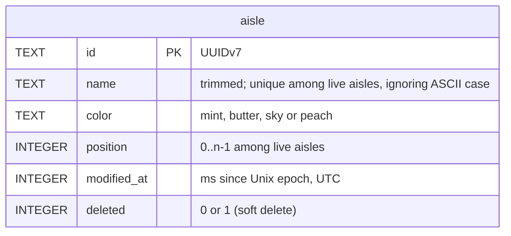

# Database schema

The migrations in [core/schema/](../core/schema/) are the source of truth; this page explains them. Conventions shared by every table are in [CLAUDE.md](../CLAUDE.md#database-conventions).

## aisle

User-defined aisles that group the shopping list. Created by `001_catalog.sql`, managed by `core::AisleStore`, tested in `core/tests/aisleStoreTests.cpp`.

**Name**
- Trimmed of ASCII whitespace; empty → `EmptyName`.
- Unique among live aisles, ignoring ASCII case → `DuplicateName`. The store mirrors the partial index `aisle_name_live` (`COLLATE NOCASE ... WHERE deleted = 0`), so a deleted aisle's name can be reused. Non-ASCII letters don't fold: "Épices" and "épices" are different names.

**Color**: `core::AisleColor`, stored as its TEXT name. The CHECK constraint lists the same values.

**Position**: live aisles always have positions 0..n-1, without gaps. There's deliberately no unique index on `position`: SQLite checks UNIQUE row by row, so shifting several positions in one UPDATE would collide halfway.

**Operations**

| Operation | Effect |
| --- | --- |
| create | Appended last. |
| rename, setColor | One row. No write if nothing changes. |
| move(from, to) | The aisles in between shift by one. |
| remove | Soft delete (`deleted = 1`), then the live aisles after it shift up to close the gap. The deleted row keeps its old position. |
| restore | Back at min(old position, live count), shifting the others down. Fails with `DuplicateName` if a live aisle took the name meanwhile. |

- move, remove and restore are each one transaction.
- `modified_at` is updated on every row a change touches, including rows shifted by move, remove or restore.

**Seed rows**: Produce (mint), Dairy & eggs (butter), Meat & fish (peach), Pantry (sky), at positions 0 to 3. Their ids and `modified_at` are fixed, so every device starts with identical rows.

**"Other"** is not a row: the UI shows it for items whose aisle is gone.

**Not yet enforced**: an aisle can only be deleted while empty. That needs the shopping-list table; see the TODO in `AisleStore::remove`.
